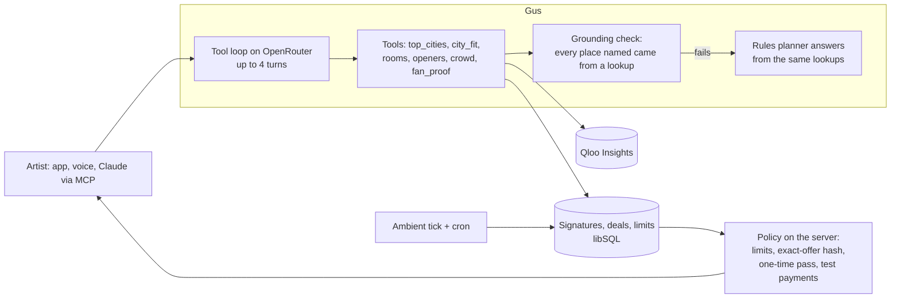

# Wanted

**Gus is an AI tour manager for independent musicians, and he runs on Qloo's taste graph.** He finds the cities and neighborhoods where an act's sound already has fans. He puts a WANTED poster up there for fans to sign. Once a city proves itself, he asks the rooms that fit for a date, haggles inside the artist's limits and brings back one yes-or-no. Built for the Qloo Agentic Hackathon, "Agents, but with taste."

- **Try it:** https://wanted-qloo.vercel.app/a/maya-ortiz?tour=1 (a 90-second guided tour from Gus; works on a phone)
- **A fan's side:** https://wanted-qloo.vercel.app/w/maya-ortiz/burlington-vt
- **Gus in Claude or ChatGPT:** add `https://wanted-qloo.vercel.app/api/mcp` as a custom connector
- **For AI readers:** [`/llms.txt`](https://wanted-qloo.vercel.app/llms.txt) and [`/llms-full.txt`](https://wanted-qloo.vercel.app/llms-full.txt)

## The problem

A singer-songwriter with 30,000 monthly listeners has fans in 200 cities and no idea which ten would fill a 150-cap room on a Tuesday. Without a booking agent, the answer comes from a streaming dashboard, guesswork and cold emails sent four to six months out. In Ditto's survey of 1,500 independent artists, 82% said they couldn't afford to tour. On the other side, NIVA found 64% of independent US stages lost money in 2024. A bad guess costs both of them.

Wanted is for the act in the middle: 5k to 80k monthly listeners, self-managed, playing 100 to 400 cap rooms. Our first focus is the Northeast and Midwest, where cities are close together and DIY rooms are plenty.

## What Gus does

1. **Hears your sound.** Paste a Spotify, Apple Music, Bandcamp or YouTube link. Gus resolves the act and a few artists it sounds like into Qloo entities.
2. **Finds where you're wanted.** Every US metro is scored for that sound with Qloo's heatmap, then normalized against a panel of 20 other acts, so a city isn't hot just because it's big. "Sleepers" are cities with far more fans than their size predicts. Inside each city he ranks the neighborhoods and the rooms that fit.
3. **Puts up a poster.** Fans sign a city's WANTED poster with their neighborhood. Each signature is opt-in proof that checks the prediction.
4. **Asks rooms.** At fifty signatures he writes to the rooms Qloo ranks for the act. He skips rooms that are dark that night and trades letters with each booker inside the artist's limits: the smallest share of the door, the biggest deposit, nights to avoid.
5. **Brings back one decision.** The offer sits next to the artist's floor. A yes pays a deposit against that exact offer, in test mode. If the terms change, the yes is void.
6. **Fills the room and settles up.** He tells the signers first and puts posters where the crowd hangs out. He finds an opener who shares the crowd and keeps the day sheet. Afterwards he checks the room's count against the door.

Gus works when no screen is open. Calls to rooms move forward on the server as time passes, plus a cron sweep (`src/server/ambient.ts`). The first visit lands with work already in progress: a call underway, an offer waiting and a date held, shown in the app's Dynamic Island.

## Why this needs an agent, and why it needs Qloo

Routing a tour is a long job with lots of waiting: score cities, wait for proof, write to rooms, wait for replies, haggle, decide, promote. An artist can't sit on it for months, and an agent can. It also needs judgment at every step, and that judgment comes from taste, which a plain LLM doesn't have.

We measured that. For the same question ("where's my crowd in this city, which rooms on a Tuesday"), we checked a general chatbot's answers against Qloo over 8 cities ([evals/qloo-vs-chatbot.md](evals/qloo-vs-chatbot.md)):

| | Plain chatbot |
|---|---|
| Rooms that hold up | 17 of 37 (46%) |
| Rooms that are wrong (closed for good, dark that night, another city) | 5 of 37 |
| Neighborhoods Qloo ranks in the top 10 for the sound | 5 of 24 |
| Cities nobody plays yet that it never mentioned | 11, including Ithaca, Missoula and Bellingham |

The same check is in the app: every city sheet has **Ask a chatbot instead?**, which runs it live and shows what holds up.

## How Wanted uses Qloo

All calls go through [`src/server/qloo/api.ts`](src/server/qloo/api.ts), and each answer keeps a receipt.

| What Gus needs | Qloo call | Where it decides |
|---|---|---|
| The act and who it sounds like | `/search`, entities by ID or Spotify ID | onboarding, [`src/server/sound.ts`](src/server/sound.ts) |
| Every US city ranked for the crowd | `/v2/insights`, `filter.type=urn:heatmap`, normalized against a panel | the map, [`src/server/score.ts`](src/server/score.ts) |
| Neighborhoods inside a city | `urn:heatmap` scoped to the city | city sheet, poster spots |
| Rooms that fit the act's taste, and why | `urn:entity:place` with `feature.explainability`, plus hours | city sheet, which rooms he asks |
| Where to put posters | `urn:entity:place` in the top neighborhoods, hang-out tags | fill the room |
| Who the fans are | `urn:demographics`; cross-domain `podcast`, `tv_show`, `movie`, `brand`; `urn:tag` | city sheet, Fan Mail, ads |
| An opener who shares the crowd | `urn:entity:artist` with a popularity cap, then `/v2/analysis/compare` | Gus's `openers` tool |

## How Gus is built



- **Lookups.** Gus answers from six lookups backed by Qloo or the act's own data ([`src/server/gus/ask.ts`](src/server/gus/ask.ts)). His answers stream: each lookup shows as it runs, then a sentence or two and one next step.
- **Grounding.** Any reply that names a city or room no lookup returned is dropped, and a rules planner answers from the lookups instead ([`src/server/gus/grounding.ts`](src/server/gus/grounding.ts)).
- **Follow-ups.** The app sends the last few turns, so "book me a room there" and "actually make it 250" know what they refer to.
- **Money.** Limits live in Gus's mandate and are enforced on the server. Each offer carries a hash of its exact terms. A yes approves that hash and mints a one-time pass for that amount, payee and 48 hours, paid idempotently ([`src/server/deals.ts`](src/server/deals.ts), [`src/server/deal-scope.ts`](src/server/deal-scope.ts)). Agent payments elsewhere work the same way: a challenge, an exact approval the model can't give, then a scoped payment.
- **Reaching you.** He picks how loudly to reach you by the stakes: a Logbook line, a note, a question, a review card, and now and then a phone call in Gus's own voice. He keeps quiet hours.
- **Outside the app.** The MCP server ([`src/server/mcp.ts`](src/server/mcp.ts)) gives Claude or ChatGPT `where_am_i_wanted`, `city_brief`, `deals`, `ask_gus` and `ask_rooms`. None of them can approve or pay.
- **Fan privacy.** Signatures, names and contacts never go to Qloo or to a model. Gus sees counts by city and neighborhood.

## Evals

| Eval | Result | Run it |
|---|---|---|
| [Asking Gus](evals/gus.md): 16 live questions through the app's route, uncached model, live Qloo | 16 of 16 ran the right lookup, offered a fitting next step and stayed short | `npm run eval:gus` |
| [Qloo against a plain chatbot](evals/qloo-vs-chatbot.md): 8 cities | 46% of the chatbot's rooms hold up | `npm run eval:chatbot` |
| [Agent gate](evals/report.md): 12 policy scenarios | 12 of 12, no rejected tool calls | `npm run eval:llm -- --extended --strict-policy` |
| Unit and policy tests | 234 pass | `npm test` |
| Production smoke: pages, JSON, share images, MCP, time budgets | | `npm run smoke:prod` |

The Gus eval now has 25 cases: single questions, questions that need two or more lookups, and follow-ups that only make sense with the turn before. Every number and name in an answer is checked against the raw lookups, and each case runs several times for a pass rate. Writing these evals caught real bugs, all now fixed. "Portland Maine" picked Oregon. Gus didn't know a poster needs fifty signatures. He'd offer to ask a room with no button to do it.

Not measured yet: real artist outcomes, ticket sales and real venue replies.

## What's real and what's simulated

| Real | Simulated, and labeled in the app |
|---|---|
| Every Qloo call: city scores, neighborhoods, rooms, crowds, openers | Venue bookers and their replies (stand-ins that answer from templates and policy) |
| Fan signatures and the poster pages | The demo act's signatures (flagged as demo) |
| Gus's tool loop, his streaming answers and his voice | Deposits (Stripe test mode or a sandbox ledger, never live money) |
| The MCP connector, approvals and payment policy | Notes to podcasts and openers aren't really sent |

## Run it

```bash
npm install
cp .env.example .env   # QLOO_API_KEY is required; the rest are optional
npm run seed           # the demo act and cached Qloo data
npm run web            # http://localhost:3100
```

- `QLOO_API_KEY` (required)
- `OPENROUTER_API_KEY` or `OPENROUTER_API_KEYS` (Gus's tool loop, writing and voice; without it, a rules planner answers and says so)
- `STRIPE_SECRET_KEY` (test keys only; live keys are refused)
- `TURSO_DATABASE_URL` and `TURSO_AUTH_TOKEN` (hosted database; defaults to a local file)

**Stack.** The web app is Next.js 16 in `web/`. The iPhone app is Expo in `src/app`, with TestFlight next. Both use the same TypeScript server (`src/server`) and API routes. libSQL on Turso, MapLibre and deck.gl for the map, OpenRouter for models, Qloo Insights for taste.

**Research.** The customer, touring and market research behind the product is in [docs/research](docs/research).

## License

MIT. See [LICENSE](LICENSE).
